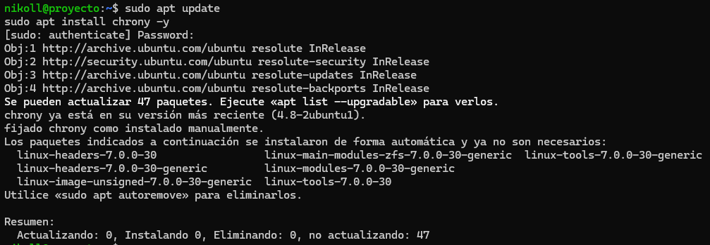
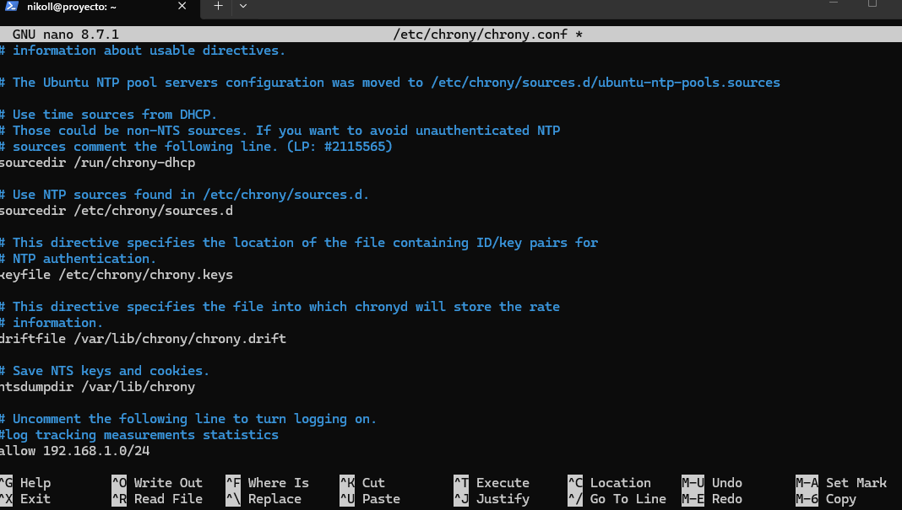
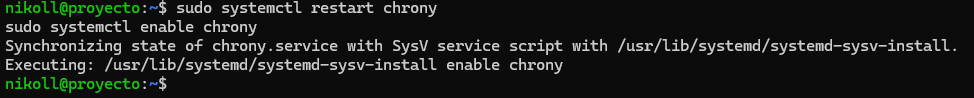
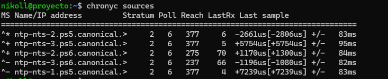
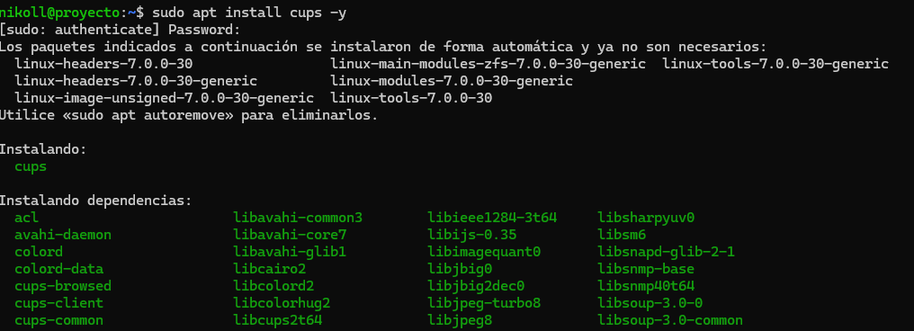
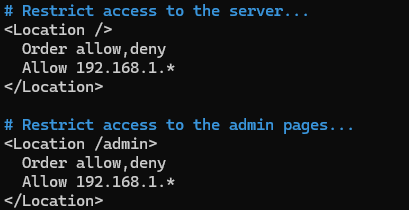
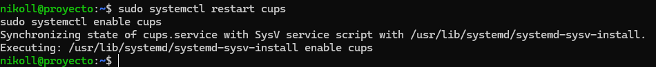
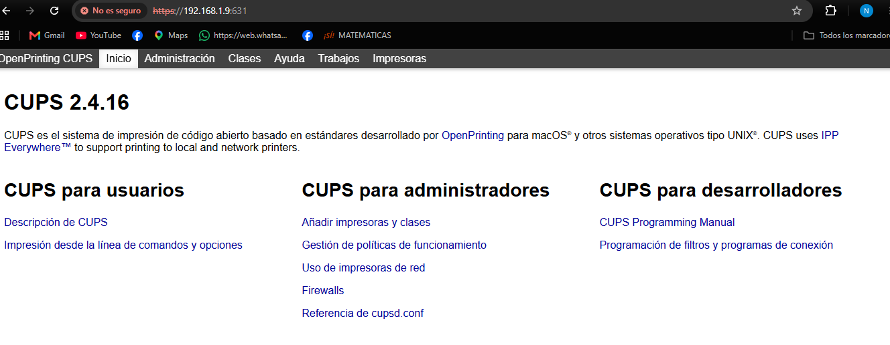
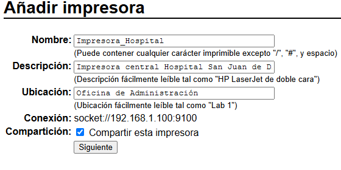
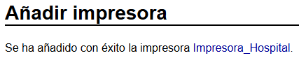

# Documentación Técnica - Implementación de Servicios 

**Proyecto:** Infraestructura de TI - Hospital San Juan de Dios de Armenia  
**Servidor:** Ubuntu Server 24.04 LTS (Máquina Virtual)  


---

## 1. Contexto de la Implementación

Como parte de la infraestructura tecnológica propuesta para el Hospital San Juan de Dios de Armenia, se llevó a cabo la instalación y configuración de los servicios.

Estos servicios se implementaron sobre un servidor Ubuntu Server 24.04 LTS, alojado en una máquina virtual permitiendo la comunicación con otros equipos de la red local.

---

## 2. Implementación y Configuración de los Servicios

### A. Servicio NTP

**Objetivo:** Proporcionar sincronización de tiempo a los equipos de la red del hospital, garantizando la precisión de los registros y eventos del sistema.

#### 2.1. Procedimiento de Instalación

Se instaló el paquete `chrony`, una herramienta utilizada en Ubuntu para la sincronización de tiempo. Primero se actualizaron los repositorios del sistema y posteriormente se ejecutó la instalación:

```bash
sudo apt update
sudo apt install chrony -y
```


#### 2.2. Configuración del Servidor

Para permitir que el servidor no solo sincronice su hora con internet, sino que también pueda atender las solicitudes de los demás equipos del hospital, se editó el archivo de configuración principal:

```bash
sudo nano /etc/chrony/chrony.conf
```
Se agregó la directiva `allow` al final del archivo, autorizando a los dispositivos pertenecientes a la subred local `192.168.1.0/24` a consultar la hora del servidor:

```bash
allow 192.168.1.0/24
```


#### 2.3. Verificación y Pruebas

Después de realizar la configuración, se reinició el servicio para aplicar los cambios y se habilitó su inicio automático con el sistema operativo:

```bash
sudo systemctl restart chrony
sudo systemctl enable chrony
```


Finalmente, se consultaron las fuentes de sincronización mediante el siguiente comando:

```bash
chronyc sources
```


**Resultado:** El comando mostró un asterisco (`*`) junto a uno de los servidores de tiempo de internet. Este símbolo indica que Chrony seleccionó dicha fuente como referencia de sincronización, confirmando que el servidor logró sincronizar su reloj correctamente.

---

### B. Servicio CUPS 

**Objetivo:** Centralizar la administración de impresoras y permitir que los equipos autorizados de la red del hospital puedan acceder al servicio de impresión.

#### 2.4. Procedimiento de Instalación

Se instaló el servidor de impresión CUPS y se agregó el usuario administrador `nikoll` al grupo `lpadmin`, encargado de gestionar las impresoras y administrar el servicio:

```bash
sudo apt install cups -y
sudo usermod -aG lpadmin $USER
```



Para aplicar los cambios relacionados con los permisos del grupo, se reinició la máquina virtual.

#### 2.5. Configuración para Acceso Remoto

Se editó el archivo principal de configuración de CUPS para permitir conexiones desde otros equipos de la red local:

```bash
sudo nano /etc/cups/cupsd.conf
```
Se realizaron los siguientes cambios:

1. Se reemplazó `Listen localhost:631` por `Listen 0.0.0.0:631`, permitiendo que el servicio escuche conexiones desde las interfaces de red del servidor.


2. Se agregó la regla `Allow 192.168.1.*` dentro de los bloques `<Location />` y `<Location /admin>`, autorizando el acceso desde los equipos pertenecientes a la red local.



Posteriormente, se reinició el servicio para aplicar la configuración y se habilitó su inicio automático:

```bash
sudo systemctl restart cups
sudo systemctl enable cups
```


#### 2.6. Verificación y Pruebas

Se realizó una prueba de acceso desde un equipo Windows conectado a la red local, ingresando a la interfaz web de administración de CUPS mediante la siguiente dirección:

`https://192.168.1.9:631`

Durante el acceso, el navegador presentó una advertencia de conexión no privada debido al uso de un certificado autofirmado. Se seleccionó la opción **Avanzado** y posteriormente **Continuar** para ingresar a la interfaz.

#### 2.7. Creación de la Impresora Compartida

Desde la interfaz web de CUPS se realizó el procedimiento para agregar una impresora:

1. Se ingresó a la pestaña **Administración** y se seleccionó la opción **Añadir impresora**.
3. Se seleccionó el tipo de conexión **AppSocket/HP JetDirect**, utilizando la dirección `socket://192.168.1.100:9100`.
4. Se asignó el nombre `Impresora_Hospital` y se habilitó la opción **Compartir esta impresora**.
5. Se seleccionó el controlador genérico **Generic PostScript** y se finalizó el proceso de creación.





Como resultado, se configuró una impresora denominada `Impresora_Hospital` dentro del servidor CUPS, habilitando su opción de compartición.



---

## 3. Parámetros Técnicos de los Servicios

Los servicios implementados utilizan los siguientes parámetros de red:

| Servicio | IP del servidor | Puerto | Protocolo | Tipo de servicio | Descripción / Acceso |
|---|---|---|---|---|---|
| **NTP (Chrony)** | 192.168.1.9 | 123 | UDP | Sincronización de tiempo | Servidor de hora para la red local. |
| **CUPS** | 192.168.1.9 | 631 | TCP | Servidor de impresión | Administración web mediante `https://192.168.1.9:631`. |

---

## 4. Resultados de la Implementación

La implementación de los servicios NTP y CUPS permitió establecer dos componentes centralizados dentro de la infraestructura tecnológica propuesta para el Hospital San Juan de Dios de Armenia.

Por una parte, Chrony permitió sincronizar el reloj del servidor con fuentes de tiempo externas y configurar el acceso para los dispositivos pertenecientes a la subred local. Por otra parte, CUPS permitió habilitar la administración remota del servicio de impresión y configurar una impresora compartida denominada `Impresora_Hospital`.

De esta manera, se establecieron las configuraciones necesarias para apoyar la sincronización horaria y la gestión centralizada de impresión dentro de la infraestructura del hospital.
