# Documentación Técnica - Implementación de Servicios 

**Proyecto:** Infraestructura de TI - Hospital San Juan de Dios de Armenia  
**Servidor:** Ubuntu Server 24.04 LTS (Máquina Virtual)  


---

## 1. Contexto de la Implementación

Como parte de la infraestructura tecnológica propuesta para el Hospital San Juan de Dios de Armenia, se llevó a cabo la instalación y configuración de los servicios.

Estos servicios se implementaron sobre un servidor Ubuntu Server 24.04 LTS, alojado en una máquina virtual permitiendo la comunicación con otros equipos de la red local.

---

## 2. Dokploy
**Paso 1.** Se verificó el estado de la infraestructura previamente instalada en Ubuntu mediante el comando sudo docker service ls. Los resultados mostraron que Dokploy, su base de datos PostgreSQL y los servicios de la práctica anterior se encontraban activos, con una réplica disponible por servicio (1/1). Por lo tanto, se tomó la decisión de reutilizar esta infraestructura para el proyecto del Hospital San Juan de Dios de Armenia, sin realizar una nueva instalación.


**Paso 2.** Luego se creó un nuevo proyecto en Dokploy, en este caso con nombre hospital-san-juan-de-dios  destinado al despliegue de la aplicación web institucional y a la administración de su base de datos.


**Paso 3.** Posteriormente se pasó a crear el Servicio web
Se creó el servicio web-hospital de tipo Application dentro del proyecto institucional. Este servicio se utilizará para desplegar la página web del hospital mediante Dokploy y Traefik.


**Paso 4.** Se preparó una carpeta independiente en Visual Studio Code para desarrollar la página web de demostración del Hospital San Juan de Dios de Armenia. Se organizó la estructura inicial del proyecto con directorios para el código fuente y los archivos públicos, utilizando Node.js y Express.js como tecnologías de desarrollo.


**Paso 5.** Se configuró el archivo package.json con los datos del proyecto y la dependencia Express.js. Posteriormente, se ejecutó npm install para instalar los paquetes necesarios para el funcionamiento de la aplicación web.


**Paso 6.** Se desarrolló el servidor de la aplicación web utilizando Express.js. Se configuró el acceso a los archivos públicos del sitio y una ruta /health para verificar su funcionamiento. El servidor utilizará el puerto 3000 y permitirá publicar la página institucional del hospital.


**Paso 7.** Se inició la aplicación mediante el comando npm start, verificando que el servidor Express.js se ejecutara correctamente en el puerto 3000.


**Paso 8.** Se comprobó desde el navegador el funcionamiento local de la página web del Hospital San Juan de Dios de Armenia. El sitio presenta información institucional y una sección de servicios de referencia, con un diseño adaptable a diferentes dispositivos.


**Paso 9.** Se creó el repositorio, un sólo repositorio donde se almacena todo el proyecto final, como fue creado por otro compañero del grupo se debía integrar el Dokploy.


**Paso 10.** Se organizó el código de la página web del Hospital San Juan de Dios de Armenia dentro de la carpeta codigo/dokploy del repositorio grupal. Se incluyeron los archivos HTML, CSS, JavaScript y la configuración de Node.js, manteniendo separados los componentes de los demás servicios del proyecto.


**Paso 11.** Publicación en GitHub
Se publicaron los archivos de la aplicación web del hospital en el repositorio GitHub del equipo, mediante un commit específico para el componente Dokploy. Esto permitirá conectar el repositorio con la plataforma y desplegar la página institucional.


**Paso 12.** Configuración del repositorio Git en Dokploy. 
Se configuró el servicio web-hospital para obtener el código desde el repositorio grupal de GitHub, utilizando la rama main y el directorio /codigo/dokploy. Esta configuración permite que Dokploy acceda a los archivos de la aplicación Express.js para realizar su despliegue.


**Paso 13.** Despliegue de la aplicación Web
Se inició el despliegue de la aplicación web del Hospital San Juan de Dios de Armenia mediante Dokploy y Nixpacks. La plataforma obtiene el código desde el repositorio GitHub y realiza el proceso de construcción necesario para ejecutar la aplicación en un contenedor Docker.


Se verificó el resultado del despliegue de la aplicación web-hospital en Dokploy, comprobando su finalización y el estado registrado por la plataforma.


**Paso 14.** Se configuró el dominio hospital.192.168.13.40.sslip.io para la aplicación web-hospital, utilizando Traefik como proxy inverso y el puerto interno 3000. Inicialmente se utilizó HTTP para comprobar el acceso local antes de configurar HTTPS.


La aplicación se visualizó correctamente desde el navegador, comprobando su funcionamiento a través de Dokploy y Traefik.


**Paso 15.** 
Verificar a través de la terminal que Ubuntu pueda acceder al sitio web.


Se configuró un túnel temporal de Cloudflare para permitir el acceso a la aplicación web del Hospital San Juan de Dios mediante una dirección pública HTTPS. Se verificó la conexión del túnel con el servidor local, permitiendo acceder al sitio sin modificar la configuración de Dokploy ni exponer directamente la máquina virtual a Internet.


**Paso 16.** Se creó el servicio MySQL db-hospital dentro del proyecto hospital-san-juan-de-dios, utilizando la base de datos hospital_db y el usuario hospital_user. Este servicio se utilizará para almacenar información de demostración que posteriormente será consultada desde la aplicación web.


**Paso 17.**  Se inició el despliegue del servicio MySQL db-hospital mediante Dokploy. Posteriormente, se verificó su estado de ejecución para comprobar que la base de datos estuviera disponible para establecer conexiones desde la aplicación web.


**Paso 18.** Se configuraron las variables de entorno de la aplicación web-hospital para establecer su conexión con la base de datos hospital_db. Se definieron el nombre del servicio MySQL, el puerto interno 3306, el usuario y la contraseña, manteniendo las credenciales fuera del código fuente.


**Paso 19.** Se instaló la biblioteca mysql2 en la aplicación Express.js mediante npm, para permitir la conexión con la base de datos MySQL administrada desde Dokploy.


**Paso 20.** Se configuró la conexión de la aplicación Express.js con MySQL mediante la biblioteca mysql2 y las variables de entorno definidas en Dokploy. También se agregó la ruta /db-test para verificar la comunicación con la base de datos.


**Paso 21.** Subir cambios
Se actualizaron los archivos de la aplicación web en el repositorio grupal de GitHub, incorporando la dependencia mysql2 y la ruta de prueba para verificar la conexión con MySQL.


Se obtuvo un error en un archivo, entonces se subió ese en solitario


**Paso 22.** Se realizó un nuevo despliegue de web-hospital mediante Dokploy para incorporar la dependencia mysql2 y la ruta de verificación de la conexión con MySQL.


**Paso 23.** Se verificó la comunicación entre la aplicación web Express.js y la base de datos MySQL mediante la ruta /db-test. Para realizar la conexión se utilizó el nombre interno del servicio proporcionado por Dokploy.


---

## 3. Implementación y Configuración de los Servicios

### A. Servicio NTP

**Objetivo:** Proporcionar sincronización de tiempo a los equipos de la red del hospital, garantizando la precisión de los registros y eventos del sistema.

#### 3.1. Procedimiento de Instalación

Se instaló el paquete `chrony`, una herramienta utilizada en Ubuntu para la sincronización de tiempo. Primero se actualizaron los repositorios del sistema y posteriormente se ejecutó la instalación:

```bash
sudo apt update
sudo apt install chrony -y
```


#### 3.2. Configuración del Servidor

Para permitir que el servidor no solo sincronice su hora con internet, sino que también pueda atender las solicitudes de los demás equipos del hospital, se editó el archivo de configuración principal:

```bash
sudo nano /etc/chrony/chrony.conf
```
Se agregó la directiva `allow` al final del archivo, autorizando a los dispositivos pertenecientes a la subred local `192.168.1.0/24` a consultar la hora del servidor:

```bash
allow 192.168.1.0/24
```


#### 3.3. Verificación y Pruebas

Después de realizar la configuración, se reinició el servicio para aplicar los cambios y se habilitó su inicio automático con el sistema operativo:

```bash
sudo systemctl restart chrony
sudo systemctl enable chrony
```


Finalmente, se consultaron las fuentes de sincronización mediante el siguiente comando:

```bash
chronyc sources
```


**Resultado:** El comando mostró un asterisco (`*`) junto a uno de los servidores de tiempo de internet. Este símbolo indica que Chrony seleccionó dicha fuente como referencia de sincronización, confirmando que el servidor logró sincronizar su reloj correctamente.

---

### B. Servicio CUPS 

**Objetivo:** Centralizar la administración de impresoras y permitir que los equipos autorizados de la red del hospital puedan acceder al servicio de impresión.

#### 3.4. Procedimiento de Instalación

Se instaló el servidor de impresión CUPS y se agregó el usuario administrador `nikoll` al grupo `lpadmin`, encargado de gestionar las impresoras y administrar el servicio:

```bash
sudo apt install cups -y
sudo usermod -aG lpadmin $USER
```


Para aplicar los cambios relacionados con los permisos del grupo, se reinició la máquina virtual.

#### 3.5. Configuración para Acceso Remoto

Se editó el archivo principal de configuración de CUPS para permitir conexiones desde otros equipos de la red local:

```bash
sudo nano /etc/cups/cupsd.conf
```
Se realizaron los siguientes cambios:

1. Se reemplazó `Listen localhost:631` por `Listen 0.0.0.0:631`, permitiendo que el servicio escuche conexiones desde las interfaces de red del servidor.


2. Se agregó la regla `Allow 192.168.1.*` dentro de los bloques `<Location />` y `<Location /admin>`, autorizando el acceso desde los equipos pertenecientes a la red local.


Posteriormente, se reinició el servicio para aplicar la configuración y se habilitó su inicio automático:

```bash
sudo systemctl restart cups
sudo systemctl enable cups
```


#### 3.6. Verificación y Pruebas

Se realizó una prueba de acceso desde un equipo Windows conectado a la red local, ingresando a la interfaz web de administración de CUPS mediante la siguiente dirección:

`https://192.168.1.9:631`

Durante el acceso, el navegador presentó una advertencia de conexión no privada debido al uso de un certificado autofirmado. Se seleccionó la opción **Avanzado** y posteriormente **Continuar** para ingresar a la interfaz.

#### 3.7. Creación de la Impresora Compartida

Desde la interfaz web de CUPS se realizó el procedimiento para agregar una impresora:

1. Se ingresó a la pestaña **Administración** y se seleccionó la opción **Añadir impresora**.
3. Se seleccionó el tipo de conexión **AppSocket/HP JetDirect**, utilizando la dirección `socket://192.168.1.100:9100`.
4. Se asignó el nombre `Impresora_Hospital` y se habilitó la opción **Compartir esta impresora**.
5. Se seleccionó el controlador genérico **Generic PostScript** y se finalizó el proceso de creación.


Como resultado, se configuró una impresora denominada `Impresora_Hospital` dentro del servidor CUPS, habilitando su opción de compartición.


---

### C. Servicio NIS

**Objetivo:** Centralizar la administración de usuarios y grupos de la red del hospital, permitiendo que diferentes equipos consulten una misma fuente de información para identificar y autenticar a los usuarios.

#### 3.8. Creación y Preparación de las instancias

Se crearon dos instancias de Ubuntu mediante Multipass, utilizando una para funcionar como servidor maestro NIS y otra como cliente.


Se identificaron las máquinas virtuales y se verificó que ambas estuvieran en funcionamiento antes de iniciar la configuración del servicio.


#### 3.9. Actualización e Instalación de los Paquetes

Primero se actualizaron los repositorios y paquetes del servidor para preparar el entorno de instalación

```bash
sudo apt update
sudo apt upgrade -y
```


Posteriormente se instalaron los paquetes necesarios para proporcional el servicio NIS

```bash
sudo apt install ypserv yp-tools rpcbind -y
```


#### 3.10. Definición del Dominio NIS

Se estableció el dominio hospital.local, que identifica el entorno NIS al que pertenecerán el servidor y sus clientes

```bash
sudo domainname hospital.local
```


#### 3.11. Configuración de las Direcciones IP

Se asignaron direcciones IP a las dos máquinas virtuales para garantizar su comunicación dentro de la red local.


Se verificaron las direcciones asignadas:


También se configuró la resolución de los nombres de las máquinas para facilitar su identificación dentro del entorno NIS


Para conservar el dominio NIS después de reiniciar el servidor, se configuró su establecimiento permanente mediante el mecanismo de inicio del sistema


#### 3.12. Creación del Usuario de Prueba e Inicialización del Servidor

Se creó una cuenta local denominada *usuario_nis*, que posteriormente sería publicada mediante los mapas NIS para permitir su consulta desde el cliente


Después de preparar el dominio y el usuario, se inicializó el servidor maestro mediante la herramienta *ypinit*:


#### 3.13. Habilitación de los Servicios y Verificación del Servidor

Se habilitaron los servicios necesarios para que el servidor NIS pudiera atender las solicitudes de los clientes y mantener su funcionamiento después de reiniciar la máquina:


Posteriormente, se verificó la comunicación con el servicio y se consultó el usuario de prueba mediante las herramientas de NIS


#### 3.14. Configuración del Cliente NIS

Una vez preparado el servidor maestro, se procedió a configurar la segunda máquina virtual para que pudiera integrarse al dominio hospital.local. Primeramente se establece el dominio NIS en el cliente:


Posteriormente, se instalaron los paquetes necesarios para que la máquina pudiera funcionar como cliente NIS:


Ahora bien, se configuró el archivo /etc/yp.conf para indicar la dirección del servidor maestro:


#### 3.15. Habilitación de los Servicios y Comprobación de la Conexión

Se habilitaron los servicios necesarios para que el cliente pudiera localizar y consultar al servidor NIS


Después se verificó que el cliente estuviera conectado correctamente al servidor maestro


#### 3.16. Integración con el Sistema de Identificación de Ubuntu

Para que Ubuntu pudiera utilizar los usuarios y grupos proporcionados por NIS, se modificó el archivo /etc/nsswitch.conf. Además, se ajustan las entradas correspondientes a usuarios, grupos y contraseñas para incluir la consulta al servicio NIS:


Con esta configuración, el sistema consulta primero sus archivos locales y mecanismos de identificación, y también puede recurrir a NIS para obtener la información centralizada

#### 3.17. Prueba de Autenticación y Creación del Directorio Personal

Finalmente, se realizó una prueba de autenticación desde el cliente utilizando la cuenta usuario_nis, creada originalmente en el servidor maestro.
El sistema solicita la contraseña de la cuenta y permite iniciar sesión correctamente, demostrando que el cliente puede utilizar sus credenciales administradas desde el servidor NIS


Adicionalmente, se habilitó el módulo pam_mkhomedir mediante la herramienta de configuración de PAM, permitiendo crear automáticamente el directorio personal del usuario cuando inicia sesión por primera vez en el cliente.
Se comprobó que el usuario había iniciado sesión correctamente y que su directorio personal correspondía a /home/usuario_nis.


---

### D. Servicio NFS

**Objetivo:** Permitir que los equipos Linux del hospital accedan a carpetas compartidas desde un servidor central, controlando quién puede leer y escribir en cada una.

Se definieron dos recursos compartidos:

| Recurso | Ruta en el servidor | Punto de montaje en el cliente | Acceso |
|---|---|---|---|
| Compartido | `/srv/nfs/hospital/compartido` | `/mnt/hospital/compartido` | Lectura y escritura, solo para el grupo `personal_hospital` |
| Protocolos | `/srv/nfs/hospital/protocolos` | `/mnt/hospital/protocolos` | Solo lectura para todos los clientes |

#### 3.18. Creación y Preparación de las Instancias

Se crearon dos instancias de Ubuntu 24.04 mediante Multipass, conectadas a la red puenteada para que pudieran comunicarse entre sí: `nfs-servidor`, que funciona como servidor NFS, y `nfs-cliente`, que monta los recursos compartidos.

```bash
multipass networks
multipass launch 24.04 --name nfs-servidor --network name="Wi-Fi"
multipass launch 24.04 --name nfs-cliente --network name="Wi-Fi"
multipass list
```
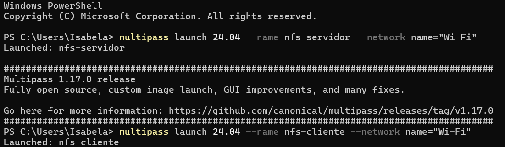

Se identificaron las direcciones IP de ambas instancias en la red puenteada: el servidor quedó con la IP `192.168.33.14` y el cliente con la IP `192.168.33.15`. Para identificar la red a la que pertenecen se ejecutó `ip route` en el servidor, obteniendo la subred `192.168.33.0/24`, que es la que se autoriza en las exportaciones. La otra red que muestra cada instancia corresponde a la red interna de Multipass y no se utilizó.

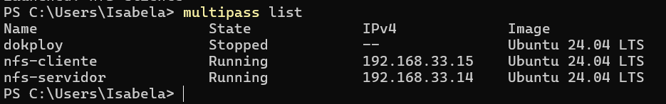

#### 3.19. Instalación del Servidor NFS

En la instancia `nfs-servidor` se actualizaron los repositorios y se instaló el paquete `nfs-kernel-server`:

```bash
sudo apt update
sudo apt install nfs-kernel-server -y
```
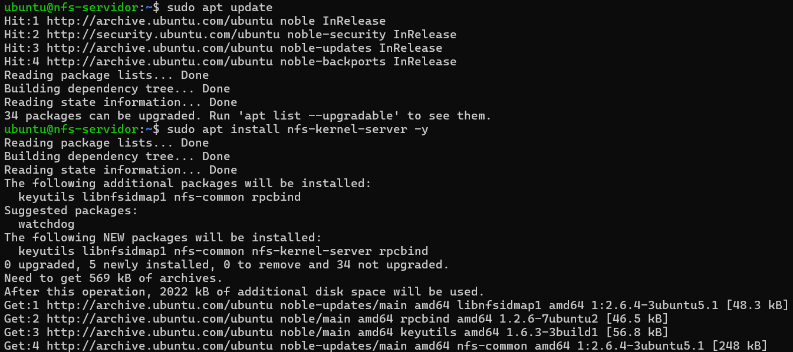

#### 3.20. Creación del Grupo, Usuario y Directorios Compartidos

Se creó el grupo `personal_hospital` (GID 3000) y el usuario `medico1` (UID 3001). Se utilizaron identificadores fijos porque NFS reconoce a los usuarios por su número (UID/GID) y no por su nombre, por lo que deben coincidir en el servidor y en el cliente.

```bash
sudo groupadd -g 3000 personal_hospital
sudo useradd -m -u 3001 -G personal_hospital -s /bin/bash medico1
id medico1
```
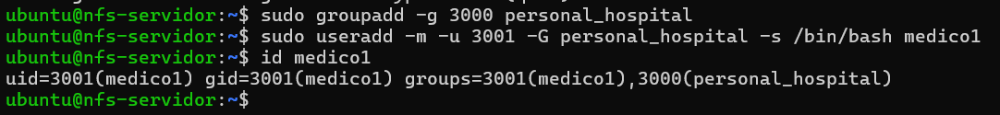

Posteriormente, se crearon los directorios que serán compartidos y se asignaron sus permisos:

```bash
sudo mkdir -p /srv/nfs/hospital/compartido /srv/nfs/hospital/protocolos

sudo chown root:personal_hospital /srv/nfs/hospital/compartido
sudo chmod 2770 /srv/nfs/hospital/compartido

sudo chown root:root /srv/nfs/hospital/protocolos
sudo chmod 755 /srv/nfs/hospital/protocolos
echo "Protocolo de lavado de manos - Hospital San Juan de Dios de Armenia" | sudo tee /srv/nfs/hospital/protocolos/protocolo_lavado_manos.txt

ls -ld /srv/nfs/hospital/*
```

- **compartido (2770):** el propietario y el grupo `personal_hospital` pueden leer y escribir; los demás usuarios no tienen acceso. El bit *setgid* (el `2` inicial) hace que los archivos nuevos pertenezcan automáticamente al grupo `personal_hospital`.
- **protocolos (755):** todos pueden leer, pero solo el administrador del servidor puede modificar su contenido.

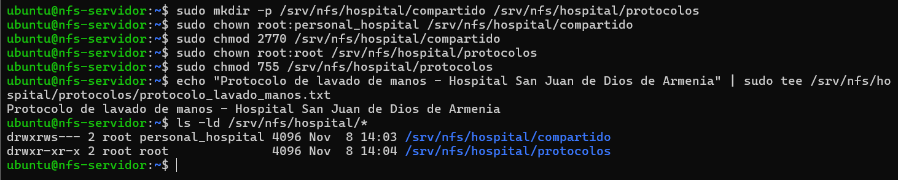

#### 3.21. Configuración de las Exportaciones

Se editó el archivo `/etc/exports` para definir qué directorios se comparten, con qué red y con qué permisos:

```bash
sudo nano /etc/exports
```
Se agregaron las siguientes líneas:

```bash
/srv/nfs/hospital/compartido  192.168.33.0/24(rw,sync,no_subtree_check,root_squash)
/srv/nfs/hospital/protocolos  192.168.33.0/24(ro,sync,no_subtree_check,root_squash)
```

- `rw` / `ro`: lectura y escritura, o solo lectura.
- `sync`: los cambios se escriben en disco antes de confirmar la operación al cliente, evitando pérdida de información.
- `root_squash`: el usuario root de un cliente se convierte en `nobody` dentro del servidor, de modo que no puede saltarse los permisos de las carpetas. Se descartó la opción `no_root_squash` de la guía del curso, porque en un hospital cualquier equipo cliente con acceso de administrador tendría control total sobre los archivos compartidos.

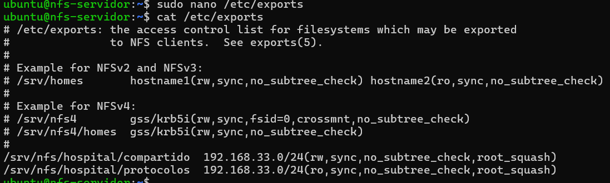

Se aplicaron las exportaciones, se habilitó el servicio y se verificó su estado:

```bash
sudo exportfs -ra
sudo systemctl enable --now nfs-kernel-server
sudo exportfs -v
sudo systemctl status nfs-kernel-server
```
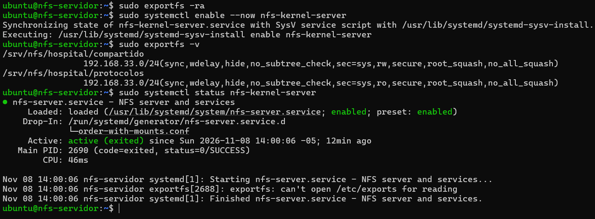

#### 3.22. Configuración del Cliente NFS

En la instancia `nfs-cliente` se instaló el paquete `nfs-common`:

```bash
sudo apt update
sudo apt install nfs-common -y
```
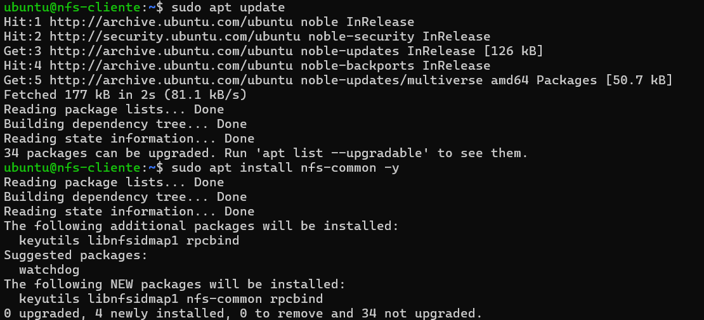

Se crearon los mismos grupo y usuario del servidor, con los mismos UID/GID, y además un usuario `visitante` (UID 3002) que **no** pertenece al grupo, para comprobar los permisos:

```bash
sudo groupadd -g 3000 personal_hospital
sudo useradd -m -u 3001 -G personal_hospital -s /bin/bash medico1
sudo useradd -m -u 3002 -s /bin/bash visitante
```

Se consultaron los recursos que publica el servidor:

```bash
showmount -e 192.168.33.14
```
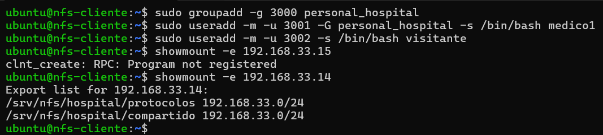

#### 3.23. Montaje de los Recursos Compartidos

Se crearon los puntos de montaje y se montaron ambos recursos:

```bash
sudo mkdir -p /mnt/hospital/compartido /mnt/hospital/protocolos
sudo mount -t nfs 192.168.33.14:/srv/nfs/hospital/compartido /mnt/hospital/compartido
sudo mount -t nfs 192.168.33.14:/srv/nfs/hospital/protocolos /mnt/hospital/protocolos
df -hT | grep nfs
```
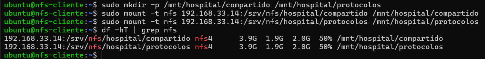

#### 3.24. Verificación y Pruebas de Permisos

**Prueba 1 – Escritura con un usuario autorizado.** El usuario `medico1`, que pertenece al grupo `personal_hospital`, pudo crear un archivo en la carpeta compartida:

```bash
sudo -u medico1 bash -c 'echo "Turno de urgencias - lunes" > /mnt/hospital/compartido/turnos_urgencias.txt'
ls -l /mnt/hospital/compartido
```

**Prueba 2 – Acceso de un usuario no autorizado.** El usuario `visitante` no pudo listar ni escribir en la carpeta, y el sistema respondió `Permission denied`:

```bash
sudo -u visitante ls /mnt/hospital/compartido
sudo -u visitante touch /mnt/hospital/compartido/prueba.txt
```

**Prueba 3 – root del cliente (root_squash).** Incluso el usuario root del cliente recibió `Permission denied`, porque el servidor lo trató como `nobody`:

```bash
sudo touch /mnt/hospital/compartido/prueba_root.txt
```
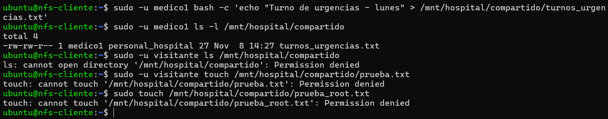

**Prueba 4 – Recurso de solo lectura.** En la carpeta de protocolos se pudo leer el archivo, pero al intentar escribir el sistema respondió `Read-only file system`:

```bash
cat /mnt/hospital/protocolos/protocolo_lavado_manos.txt
sudo -u medico1 touch /mnt/hospital/protocolos/nuevo.txt
```
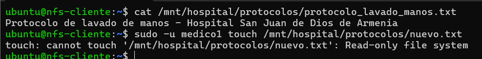

**Prueba 5 – Verificación desde el servidor.** En `nfs-servidor` se comprobó que el archivo creado desde el cliente quedó almacenado con el propietario `medico1` (UID 3001) y el grupo `personal_hospital` (GID 3000). Se utilizó `sudo` porque el usuario administrador `ubuntu` no pertenece al grupo `personal_hospital` y, por los permisos `2770`, no puede acceder a la carpeta; al intentarlo sin `sudo` el sistema respondió `Permission denied`, lo que confirma que la restricción también se aplica en el servidor.

```bash
sudo ls -ln /srv/nfs/hospital/compartido
sudo cat /srv/nfs/hospital/compartido/turnos_urgencias.txt
```
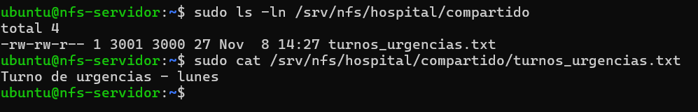

#### 3.25. Montaje Permanente

Para que los recursos se monten automáticamente al iniciar el cliente, se agregaron las siguientes líneas al final de `/etc/fstab`:

```bash
192.168.33.14:/srv/nfs/hospital/compartido  /mnt/hospital/compartido  nfs  defaults,_netdev,nofail  0  0
192.168.33.14:/srv/nfs/hospital/protocolos  /mnt/hospital/protocolos  nfs  ro,defaults,_netdev,nofail  0  0
```

La opción `_netdev` indica que se debe esperar a que la red esté disponible, y `nofail` permite que el cliente arranque aunque el servidor no responda. Se reinició el cliente y se verificó que los recursos quedaran montados:

```bash
sudo systemctl daemon-reload
sudo reboot
# después del reinicio:
df -hT | grep nfs
```
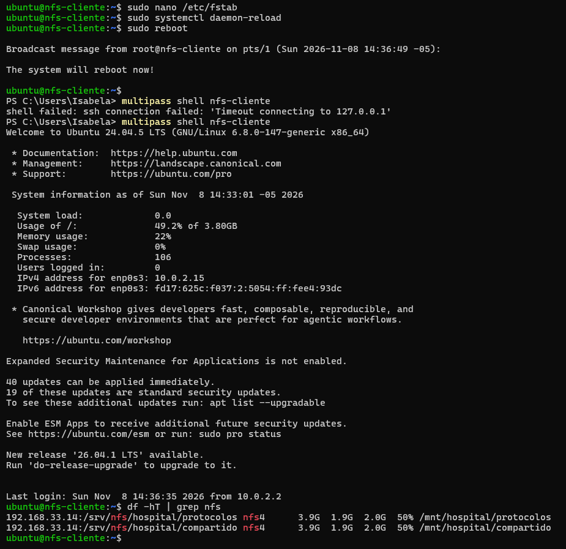


---

### E. Servicio Samba

**Objetivo:** Implementar y verificar el servicio de compartición de archivos con Samba, que permita a los equipos Windows y Mac del Hospital Departamental Universitario del Quindío San Juan de Dios acceder a una carpeta compartida con control de acceso por usuario y grupo.

#### 3.26. Verificar Multipass

Primero que todo procedemos a verificar si ya tenemos Multipass en nuestro dispositivo, utilizamos el comando `multipass version`y para verificar que hipervisor está usando Multipass para ejecutar las máquinas virtuales utilizamos el comando `multipass get local.driver`. 

```bash
multipass version
multipass get local.driver
```

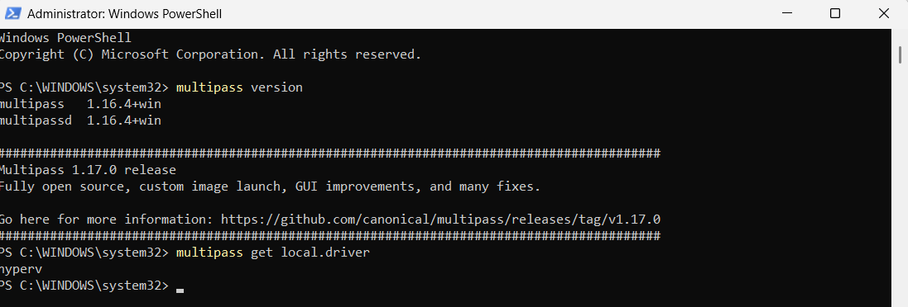

#### 3.27. Crear la instancia de la MV con Multipass

Después de verificar multipass, procedemos a crear una instancia con la versión de ubuntu `24.04`, su respectivo nombre `samba-hospital`, y características técnicas como 2 cpus, 2GB de memoria RAM y 15GB de disco. Para crear la instancia utilizamos el comando `multipass launch 24.04 --name samba-hospital --cpus 2 --memory 2G --disk 15G`. Luego verificamos que la instancia se encuentre en ejecución y aprovechamos para consultar su dirección IP con el comando `multipass list` que más adelante será util.  

```bash
multipass launch 24.04 --name samba-hospital --cpus 2 --memory 2G --disk 15G
multipass list
multipass info samba-hospital
```

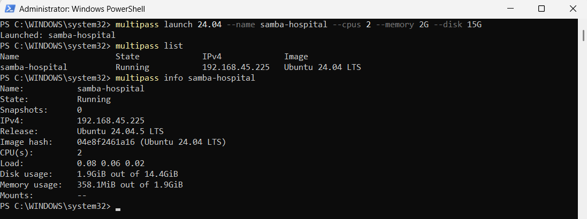

#### 3.28. Entrar a la terminal de la instancia y verificar el sistema

Luego de crear la instancia, necesitamos ingresar a la terminal de está para empezar con la implementación del servicio Samba, para esto utilizamos el comando `multipass shell samba-hospital`. Luego verificamos el sistema de la instancia con los comandos `lsb_release -a` para ver detalles del sistema de la instancia y `hostname -I` para consultar directamente la IP de la instancia.

```bash
multipass shell samba-hospital
lsb_release -a
hostname -I
```

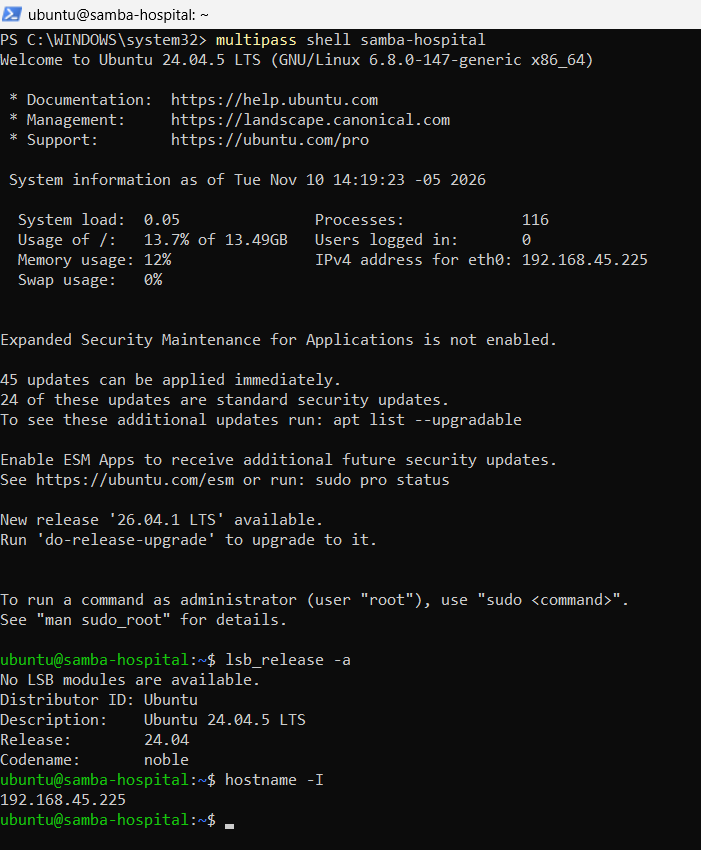

#### 3.29. Actualizar paquetes de la instancia

Antes de realizar la instalación de Samba, primero necesitamos actualizar los paquetes con el comando `sudo apt update && sudo apt upgrade -y`.

```bash
sudo apt update && sudo apt upgrade -y
```

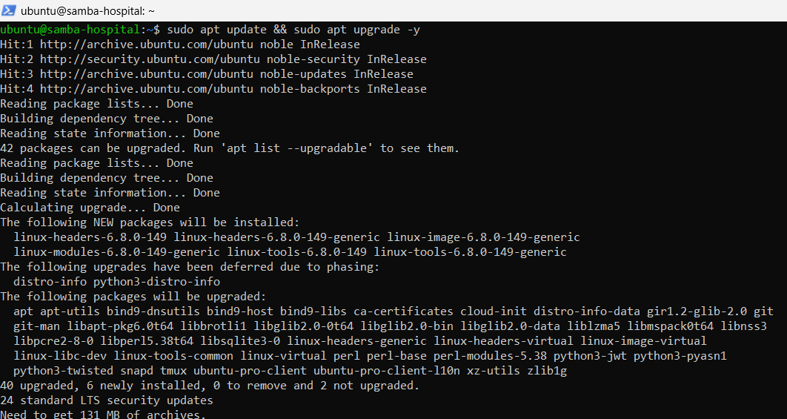

#### 3.30. Instalación de Samba

Ahora sí, procedemos con la instalación de Samba, después de actualizar los paquetes y realizar ciertas verificaciones. Para instalar el servicio utilizamos el comando `sudo apt install samba smbclient -y`.

```bash
sudo apt install samba smbclient -y
```

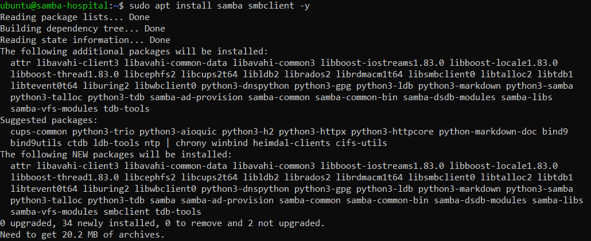

#### 3.31. Verificar la instalación y estado de Samba

Luego de realizar la instalación del servicio, seguimos con la verificación de lo que se ha instalado, para ello se utilizan varios comandos, primeramente comprobamos la versión de samba instalada con el comando `smbd --version`, luego para verificar el estado del servicio `smbd` utilizamos el comando `sudo systemctl status smbd --no-pager`. Por último verificamos el estado del servicio `nmbd` con un comando similar al anterior `sudo systemctl status nmbd --no-pager`.

```bash
smbd --version
sudo systemctl status smbd --no-pager
`sudo systemctl status nmbd --no-pager`
```

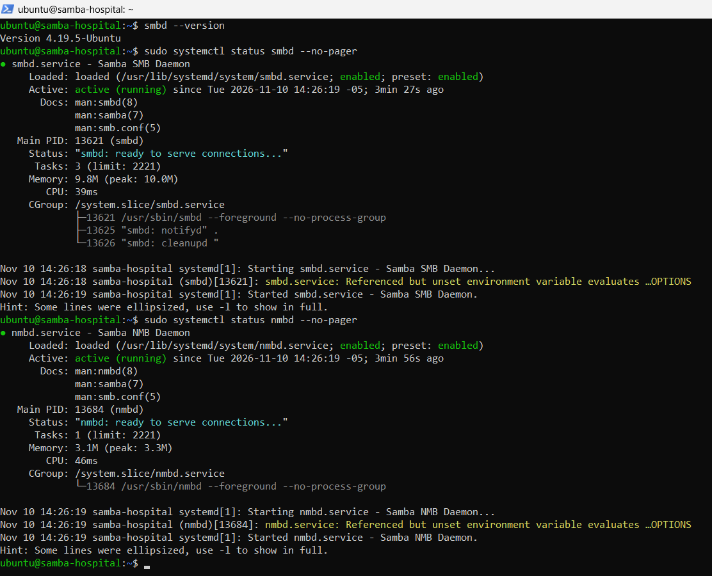

#### 3.32. Crear respaldo de configuración inicial

Para realizar un respaldo de la configuración inicial, vamos a crear una copia del archivo smb.conf en la misma ubicación pero con el nombre `smb.conf.original`, para ello utilizamos el comando `sudo cp /etc/samba/smb.conf /etc/samba/smb.conf.original` y luego para verificar que se ha creado el respaldo correctamente usamos el comando `ls -l /etc/samba/`. 

```bash
sudo cp /etc/samba/smb.conf /etc/samba/smb.conf.original
ls -l /etc/samba/
```

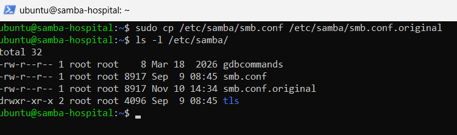

#### 3.33. Crear grupo y usuarios con acceso a los archivos compartidos

Posteriormente seguimos con la creación del grupo en donde van a ir los usuarios que van a tener acceso a los archivos compartidos, pero también crearemos un usuario externo para realizar pruebas más adelante. Primero creamos el grupo `sambausers` con el comando `sudo groupadd sambausers`. Luego creamos dos usuarios, uno lo agregaremos al grupo creado anteriormente y el otro solamente lo creamos sin agregarlo al grupo `sambausers`. Para crear el primer usuario utilizamos el comando `sudo useradd -M -s /usr/sbin/nologin -G sambausers usuario_hospital` y para crear el segundo usuario es un comando muy similar `sudo useradd -M -s /usr/sbin/nologin usuario_externo`. Por último verificamos ambos usuarios con los comandos `id usuario_hospital` y `id usuario_externo`, en donde se puede comprobar que el usuario `usuario_hospital` pertenece al grupo sambausers mientras que el usuario `usuario_externo` no pertenece a ese grupo. 

```bash
sudo groupadd sambausers
sudo useradd -M -s /usr/sbin/nologin -G sambausers usuario_hospital
sudo useradd -M -s /usr/sbin/nologin usuario_hospital
id usuario_hospital
id usuario_externo
```

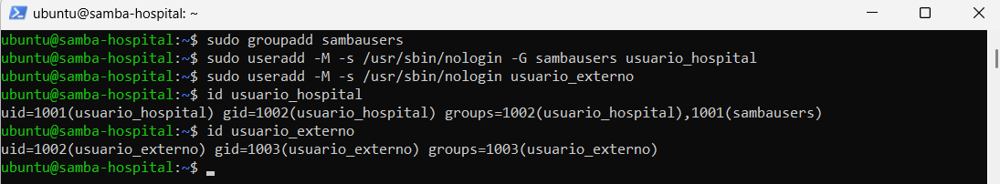

#### 3.34. Crear la carpeta compartida y asignar permisos 

Luego de tener los usuarios creados, seguimos con la parte de crear la carpeta que se va a compartir entre el servidor y los usuarios, en este caso solo es `usuario_hospital`. Para crear la carpeta compartida utilizamos el comando `sudo mkdir -p /srv/samba/hospital`. Además asignamos permisos `2770` al grupo `sambausers` anteriormente creado con los comandos `sudo chown root:sambausers /srv/samba/hospital` y `sudo chmod 2770 /srv/samba/hospital`. Por último verificamos que los permisos hayan sido asignados correctamente con `ls -ld /srv/samba/hospital`.

```bash
sudo mkdir -p /srv/samba/hospital
sudo chown root:sambausers /srv/samba/hospital
sudo chmod 2770 /srv/samba/hospital
ls -ld /srv/samba/hospital
```

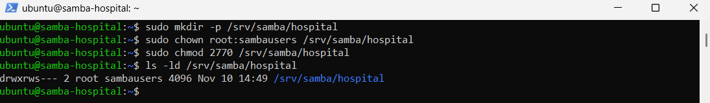

#### 3.35. Crear contraseñas a los usuarios registrados en el punto 3.33 

Ahora creamos las contraseñas para cada uno de los usuarios creados con anterioridad. Pata crear la contraseña del usuario `usuario_hospital` usamos el comando `sudo smbpasswd -a usuario_hospital` y para el otro usuario `usuario_externo` usamos el mismo comando solo que cambiamos la última parte y quedaría así `sudo smbpasswd -a usuario_externo`. Por último verificamos los usuarios que se encuentran registrados a través de este comando `sudo pdbedit -L`.

```bash
sudo smbpasswd -a usuario_hospital
sudo smbpasswd -a usuario_externo
sudo pdbedit -L
```

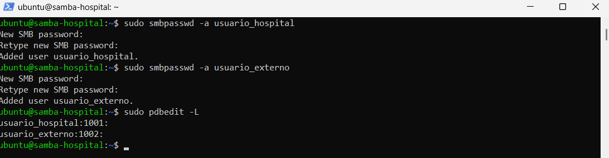

#### 3.36. Configurar el recurso compartido 

Para configurar el recurso compartido, el cual se encuentra en la ruta `/srv/samba/hospital`, debemos de modificar el archivo `smb.conf` con el siguiente comando `sudo tee -a /etc/samba/smb.conf > /dev/null << 'EOF'`. Inicialmente en la modificación se incluye el apartado `[hospital]` y allí dentro se agrega un comentario con la etiqueta `comment`, la ruta con `path`, permisos de lectura y escritura con las etiquetas `browseable` y `writable` respectivamente, no se permite que invitados puedan acceder a el contenido que se encuentre allí usando la etiqueta `guest ok`, los usuarios con acceso son aquellos que se encuentren en el grupo `sambausers`, etc. Luego con el comando `tail -n 14 /etc/samba/smb.conf` verificamos que se hayan agregado las nuevas líneas al final del archivo `smb.conf`.

```bash
sudo tee -a /etc/samba/smb.conf > /dev/null << 'EOF'
tail -n 14 /etc/samba/smb.conf
```

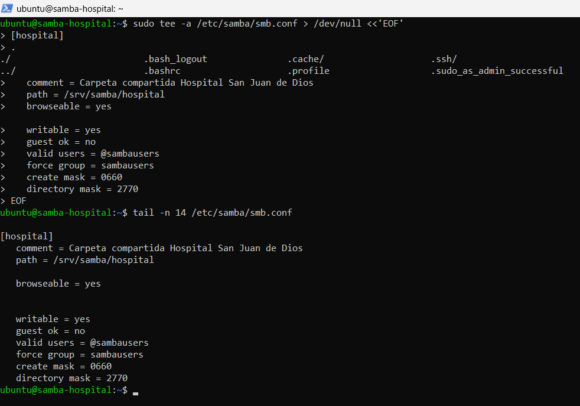

#### 3.37. Validar sintaxis del archivo smb.conf 

Para validar la sintaxis del archivo `smb.conf` y evitar romper el servicio más adelante, verificamos el contenido del archivo con el comando `testparm -s`, allí se puede observar el bloque que hemos agregado anteriormente `[hospital]` y algunos de las etiquetas agregadas.

```bash
testparm -s
```

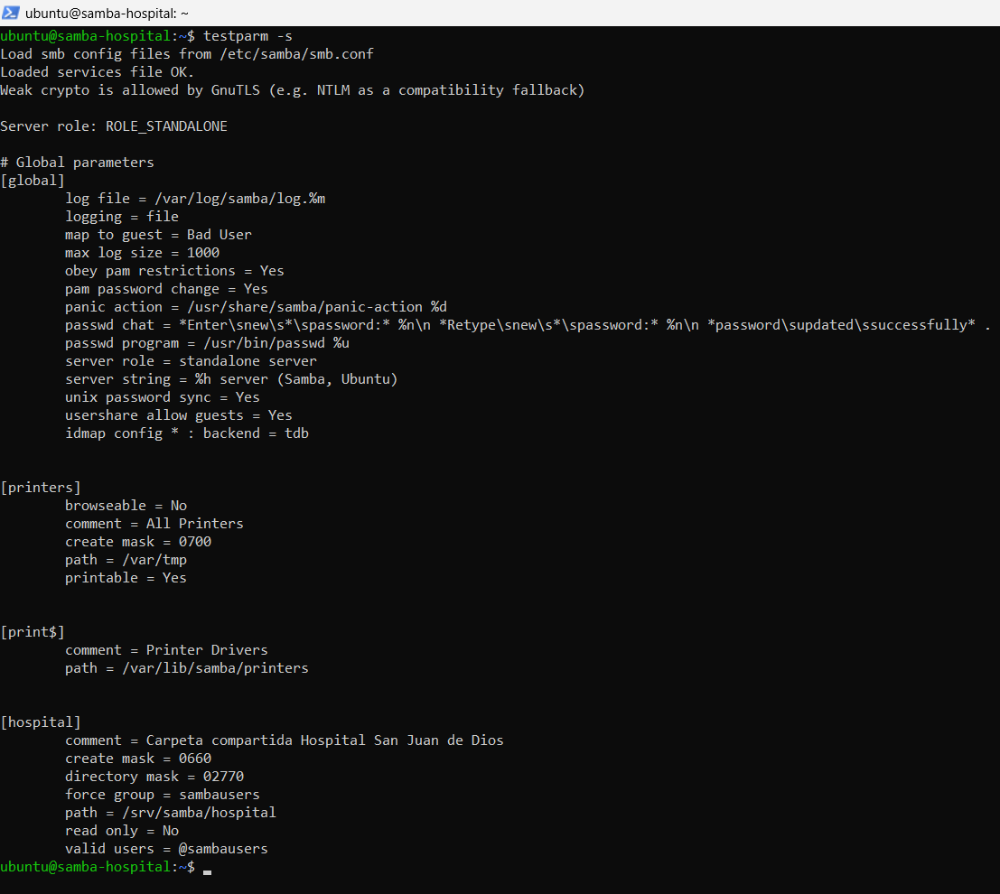

#### 3.38. Reiniciamos los servicios smbd y nmbd y validamos los puertos TCP y UDP

Primero reiniciamos los servicios `smbd` y `nmbd` con el comando `sudo systemctl  restart smbd nmbd`. Luego verificamos  el estado en el que se encuentra el servicio utilizando el comando `sudo systemctl status smbd --no-pager`. En el resultado del comando anterior se puede observar que el servicio se encuentra activo y corriendo. Por último verificamos los puertos utilizados por los protocolos TCP y UDP y para ello utilizamos el comando `sudo ss -tulpn | grep -E 'smbd|nmbd'`, en donde se puede observar que el protocolo TCP usa los puertos `139` y `445` y el protocolo UDP usa los puertos `137` y `138`, lo cual es lo esperado.

```bash
sudo systemctl  restart smbd nmbd
sudo systemctl status smbd --no-pager
sudo ss -tulpn | grep -E 'smbd|nmbd'
```

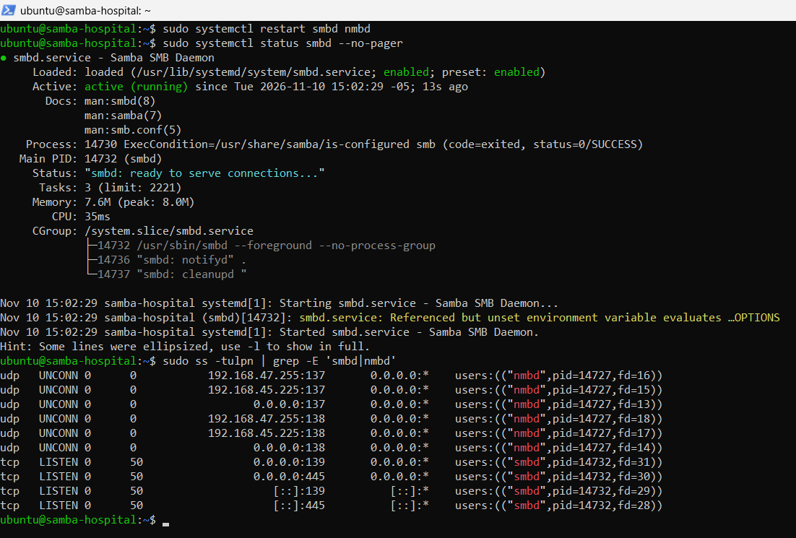

#### 3.39. Prueba local con smbclient utilizando el usuario `usuario_hospital`

Para realizar la prueba directamente en la instancia, utilizamos estos dos comandos `smbclient -L localhost -U usuario_hospital` y `smbclient //localhost/hospital -U usuario_hospital`. El primer comando nos permite ver el recurso compartido, el cual es `hospital` y allí se observa el comentario que hemos puesto anteriormente `Carpeta compartida Hospital San Juan de Dios` y el segundo nos permite ingresar a la carpeta y crear un archivo de prueba, en este caso llamado `prueba_admin`. Cabe recalcar que para ambos comandos se debe ingresar la contraseña del usuario que se esté utilizando.

```bash
smbclient -L localhost -U usuario_hospital
smbclient //localhost/hospital -U usuario_hospital
```

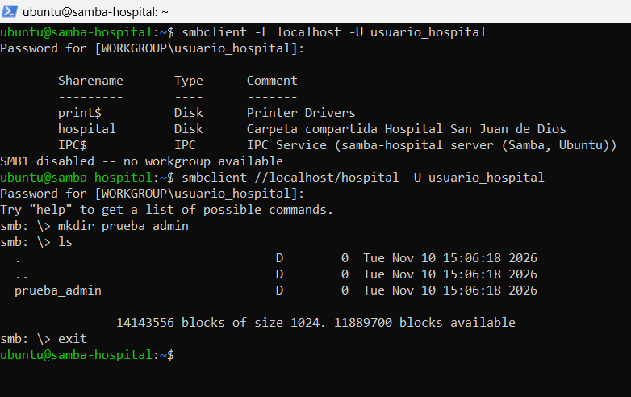

#### 3.40. Prueba local con smbclient utilizando el usuario `usuario_externo`

Después de realizar la prueba con el usuario autorizado, ahora vamos a probar con el usuario que no se encuentra en el grupo creado inicialmente, el cual es `usuario_externo`. Para realizar la prueba usamos el mismo comando anterior solo que cambiando el nombre del usuario `smbclient //localhost/hospital -U usuario_externo`. Después de ingresar la contraseña del usuario nos aparece el siguiente mensaje `tree connect failed: NT_STATUS_ACCESS_DENIED`, lo cual es el resultado esperado porque este usuario no tiene autorización de ingresar al recurso compartido.

```bash
smbclient //localhost/hospital -U usuario_externo
```

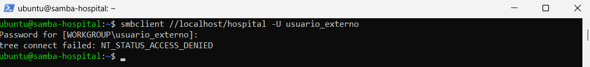

#### 3.41. Verificar estado del firewall

Por último verificamos el estado del firewall con el comando `sudo ufw status`. Para este caso el firewall se encuentra inactivo, lo cual indica que no existe ningún tipo de bloqueo, pero el caso contrario sería que se encontrará activo, en esa situación tocaría abrir los puertos correspondientes.

```bash
sudo ufw status
```

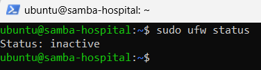

#### 3.42. Verificar la conexión de la red desde una terminal cualquiera de PowerShell en Windows

Para verificar la conexión de la red utilizamos el comando `Test-NetConnection -ComputerName 192.168.45.225 -Port 445`, en donde se espera que el resultado de la variable `TcpTestSucceeded` sea `True`, y este se puede observar al final.

```bash
Test-NetConnection -ComputerName 192.168.45.225 -Port 445
```

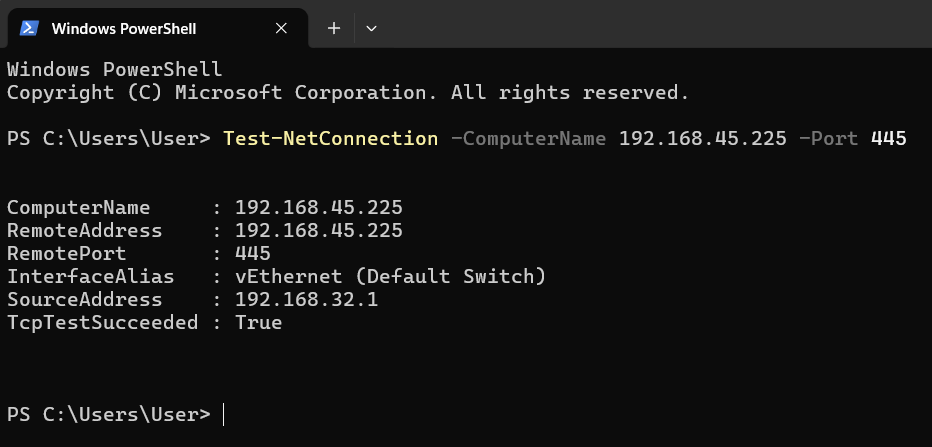

#### 3.43. Ingresar al servicio desde Windows

Una forma de ingresar al servicio desde la máquina anfitrión, en este caso el computador con Windows, primero hacemos la combinación de teclas `Win + R` e ingresamos el siguiente texto `\\192.168.45.225\hospital`, allí se puede observar la dirección de la instancia, la cual consultamos en los primeros pasos, ahora es momento de usarla. Lueg aparece una ventana emergente en donde debemos ingresar las credenciales del usuario autenticado, con su nombre de usuario `usuario_hospital` y su respectiva contraseña. Por último se puede ver que el ingreso ha sido exitoso, en donde se puede observar la carpeta compartida que se ha creado anteriormente.

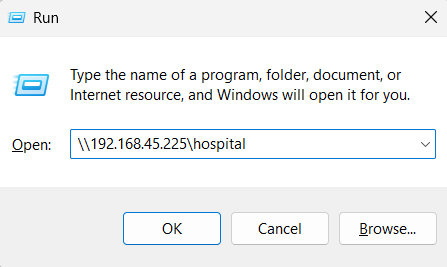

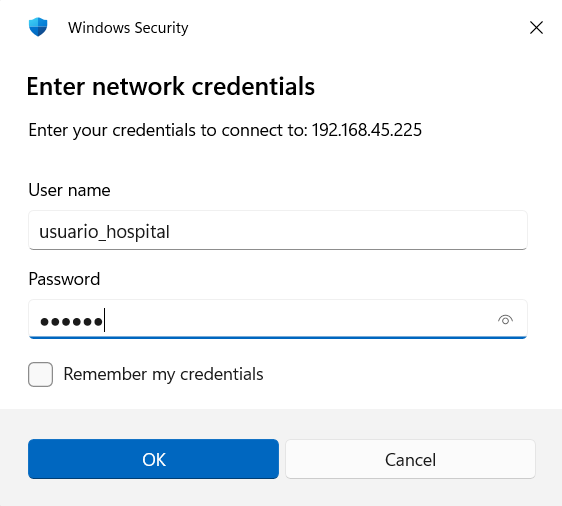

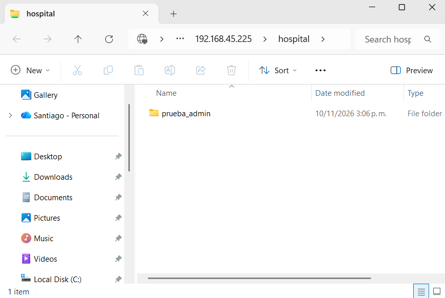

#### 3.44. Crear un archivo de prueba desde Windows

Después de haber ingresado a la carpeta compartida, crearemos un archivo de prueba dentro del directorio `prueba_admin` llamado `prueba_windows.txt` y con el contenido `Probando escritura desde Windows`. También crearemos un directorio de prueba llamado `documentos`, el cual se encuentra dentro del recurso compartido llamado `hospital`.

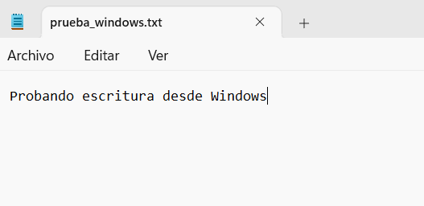

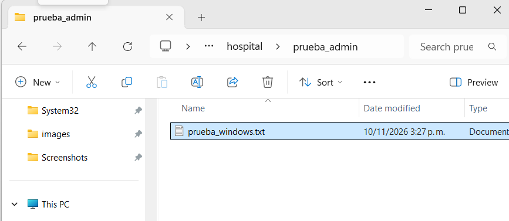

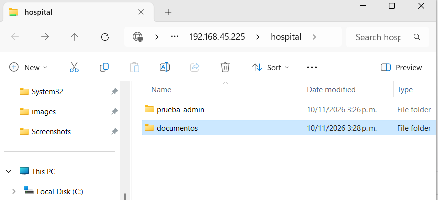

#### 3.45. Verificar los archivos creados desde la instancia

Después de haber creado el archivo txt `prueba_admin` y el directorio `documentos`, necesitamos verificar que en la instancia se puedan ver estos archivos, entonces volvemos a la terminal de la máquina virtual y utilizamos estos dos comandos `sudo ls -l /srv/samba/hospital` y `sudo smbstatus`, en donde el primero permite observar que allí se encuentran los archivos creados, mientras que el segundo nos permite ver la conexión activa desde la máquina anfitrión.

```bash
sudo ls -l /srv/samba/hospital
sudo smbstatus
```

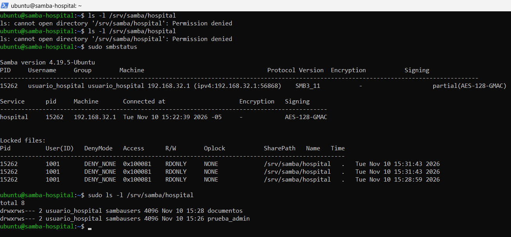

#### 3.46. Prueba con usuario no autorizado desde Windows

Por último realizaremos una prueba con el usuario no autenicado que hemos creado inicialmente `usuario_externo`. Al igual que la prueba con el usuario autenticado, primero hacemos la combinación de teclas `Win + R` e ingresamos `\\192.168.45.225\hospital`, después nos aparece la ventana emergente en donde debemos ingresar las credenciales del usuario, con su nombre de usuario `usuario_externo` con su respectiva contraseña. Al intentar ingresar nos aparece el mensaje `Access is denied`. Esto brinda confianza a los usuarios del servicio, debido a que no se permite el acceso a los archivos del hospital a cualquier persona, sino exclusivamente a la autorizada. 


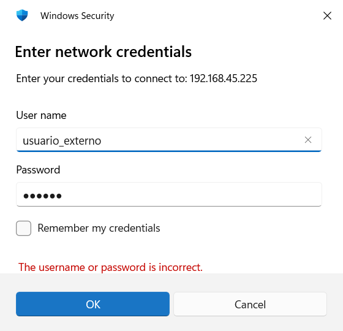

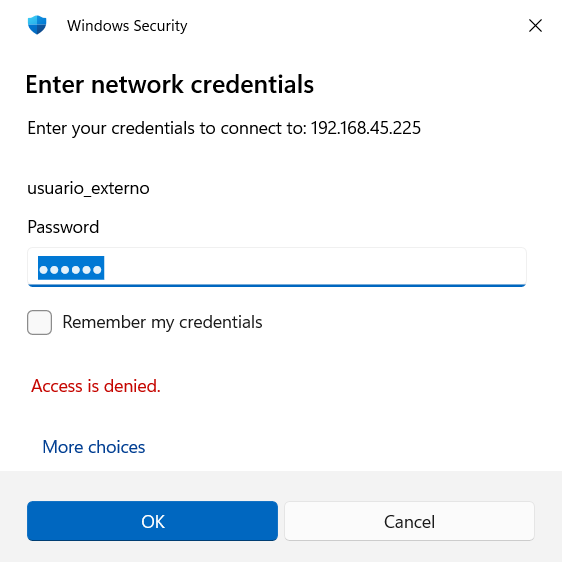


---

## 4. Parámetros Técnicos de los Servicios

Los servicios implementados utilizan los siguientes parámetros de red:

| Servicio | IP del servidor | Puerto | Protocolo | Tipo de servicio | Descripción / Acceso |
|---|---|---|---|---|---|
| **NTP (Chrony)** | 192.168.1.9 | 123 | UDP | Sincronización de tiempo | Servidor de hora para la red local. |
| **CUPS** | 192.168.1.9 | 631 | TCP | Servidor de impresión | Administración web mediante `https://192.168.1.9:631`. |
| **NIS (ypserv)** | 192.168.1.18 | 111 y 871 | TCP/UDP | Autenticación centralizada | Servidor maestro NIS del dominio hospital.local. El puerto 111 corresponde a rpcbind y el 871 al servicio ypserv. |
| **Dokploy** | 192.168.13.40 | 3000 | TCP/HTTP | Plataforma de despliegue | Panel de administración disponible en `http://192.168.13.40:3000`. |
| **Aplicación web (Express.js)** | 192.168.13.40 | 3000 (interno), 80 (acceso web) | TCP/HTTP | Servidor web institucional | Sitio de demostración del hospital disponible en `http://hospital.192.168.13.40.sslip.io`. |
| **MySQL** | 192.168.13.40 | 3306 (interno) | TCP | Base de datos relacional | Base de datos `hospital_db`, desplegada mediante Dokploy y conectada con la aplicación web a través de la red interna de Docker. |
| **Cloudflare Tunnel** | Acceso mediante túnel temporal | 443 (HTTPS público) | HTTPS | Acceso web seguro temporal | Permite acceder a la aplicación mediante una dirección HTTPS generada por Cloudflare mientras el túnel permanece activo. |
| **NFS (nfs-kernel-server)** | 192.168.33.14 | 2049 (y 111 rpcbind) | TCP/UDP | Compartición de archivos Linux | Recursos `/srv/nfs/hospital/compartido` (lectura/escritura) y `/srv/nfs/hospital/protocolos` (solo lectura), montados en `/mnt/hospital/` en los clientes. |
| **Samba (smbd / nmbd)** | 192.168.45.225 | 445 y 139 (TCP); 137 y 138 (UDP) | TCP/UDP | Compartición de archivos Windows/Mac | Recurso `hospital` (`/srv/samba/hospital`) de lectura y escritura restringido al grupo `sambausers`, accesible desde Windows mediante `\\192.168.45.225\hospital`. El puerto 445 corresponde a SMB y los puertos 139, 137 y 138 a NetBIOS. |

---

## 5. Resultados de la Implementación

La implementación de los servicios NTP y CUPS permitió establecer dos componentes centralizados dentro de la infraestructura tecnológica propuesta para el Hospital San Juan de Dios de Armenia.

Por una parte, Chrony permitió sincronizar el reloj del servidor con fuentes de tiempo externas y configurar el acceso para los dispositivos pertenecientes a la subred local. Por otra parte, CUPS permitió habilitar la administración remota del servicio de impresión y configurar una impresora compartida denominada `Impresora_Hospital`.

De esta manera, se establecieron las configuraciones necesarias para apoyar la sincronización horaria y la gestión centralizada de impresión dentro de la infraestructura del hospital.

Ahora bien, NIS permitió centralizar la administración de usuarios y grupos mediante una arquitectura cliente-servidor. Se configuró un servidor maestro para el dominio hospital.local y se integró una máquina cliente que pudo consultar los usuarios publicados e iniciar sesión utilizando una cuenta creada en el servidor. También se habilitó la creación automática del directorio personal para los usuarios que iniciaran sesión por primera vez. Gracias a esto se puede administrar las identidades dentro del entorno de red implementado para el hospital.

En cuanto a NFS, se configuró un servidor que comparte dos recursos con los equipos Linux de la red: una carpeta de trabajo con lectura y escritura restringida al grupo `personal_hospital`, y una carpeta de protocolos institucionales de solo lectura. Las pruebas comprobaron que un usuario autorizado puede crear archivos, que un usuario externo al grupo y el usuario root del cliente son rechazados gracias a los permisos y a la opción `root_squash`, y que la carpeta de protocolos no admite escritura. Además, los recursos quedaron montados de forma permanente mediante `/etc/fstab`.

Por otra parte, se implementó **Dokploy** en una máquina virtual Ubuntu con dirección IP `192.168.13.40`, reutilizando la infraestructura de contenedores Docker previamente configurada. Desde su panel de administración se creó el proyecto `hospital-san-juan-de-dios`, dentro del entorno `production`, para organizar el despliegue de la aplicación web y su base de datos.

Se desarrolló una página web institucional de demostración utilizando **Node.js y Express.js**, con información general del hospital y secciones de presentación de servicios. El código fuente se incorporó al repositorio grupal de GitHub y posteriormente se desplegó mediante Dokploy, utilizando Git como proveedor del código y Nixpacks para la construcción de la aplicación. El despliegue finalizó correctamente y se comprobó el funcionamiento del sitio desde un navegador mediante el dominio `hospital.192.168.13.40.sslip.io`.

Adicionalmente, se configuró un acceso **HTTPS temporal mediante Cloudflare Tunnel**, con el cual se verificó que la página podía visualizarse a través de una conexión segura. Este mecanismo permitió demostrar el acceso HTTPS sin modificar la configuración del dominio local, aunque no constituye una configuración permanente de SSL en Dokploy.

También se creó y desplegó una base de datos **MySQL 8.4.13**, identificada como `hospital_db`, mediante el servicio `db-hospital` de Dokploy. Para establecer la comunicación con la aplicación web, se instaló la dependencia `mysql2` y se configuraron las variables de entorno correspondientes al servidor, puerto, usuario, contraseña y nombre de la base de datos.

Finalmente, se implementó la ruta `/db-test`, desde la cual se ejecutó una consulta SQL a MySQL. La prueba devolvió el mensaje `conexion exitosa`, el nombre de la base de datos `hospital_db` y la versión del servidor `8.4.13`, comprobando que la aplicación Express.js podía comunicarse correctamente con el servicio de base de datos.

Con esta implementación se consiguió disponer de una aplicación web desplegada en contenedores, administrada mediante Dokploy y conectada a una base de datos MySQL. Esto complementa los servicios de infraestructura desarrollados por el equipo y permite demostrar un entorno tecnológico integrado para el proyecto académico del Hospital San Juan de Dios de Armenia.

El servicio Samba permitió compartir archivos con los equipos Windows y Mac de la red mediante un servidor Ubuntu `24.04` creado con Multipass, con dirección IP `192.168.45.225`. Se instaló Samba `4.19.5` como servidor independiente y se configuró el recurso compartido hospital, con la carpeta `/srv/samba/hospital`, lectura y escritura restringidas al grupo sambausers y sin acceso de invitados.

Las pruebas realizadas comprobaron que los servicios smbd y nmbd quedaron activos, que los puertos `445, 139, 137 y 138` se encontraban en escucha y que la configuración fue valida con testparm. Desde un cliente de Windows, el usuario autorizado pudo acceder a la carpeta compartida, crear archivos y carpetas, y la sesión fue verificada en el servidor con `smbstatus` mediante el protocolo `SMB3` con firma de mensajes. Por el contrario, el intento de ingreso del usuario externo fue rechazado, tanto desde el servidor como desde Windows.

De esta manera, se logro la implementación de un servicio de archivos centralizado, con acceso controlado por usuario y grupo, que complementa los servicios de infraestructura desarrollados por el equipo para el Hospital San Juan de Dios.
